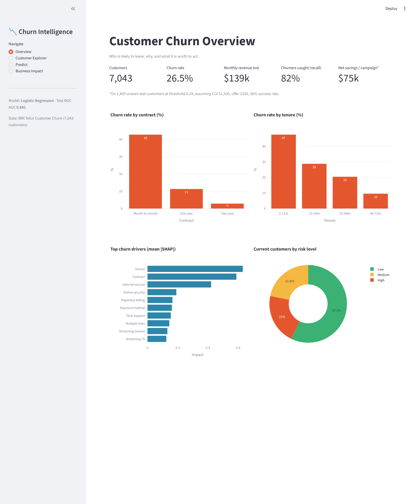
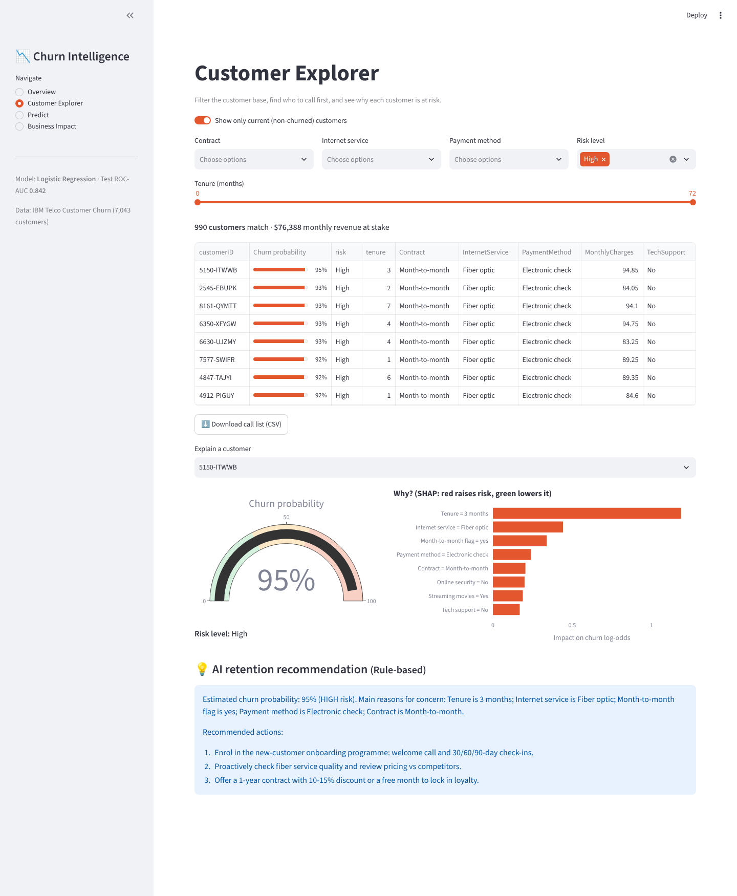
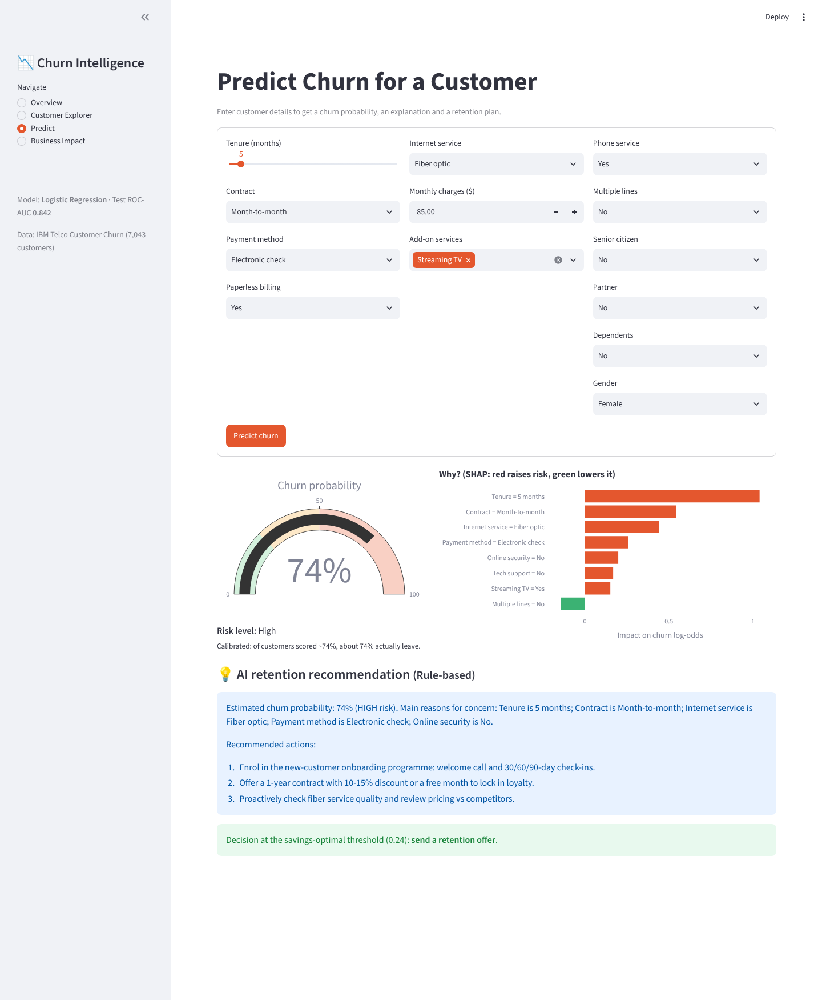
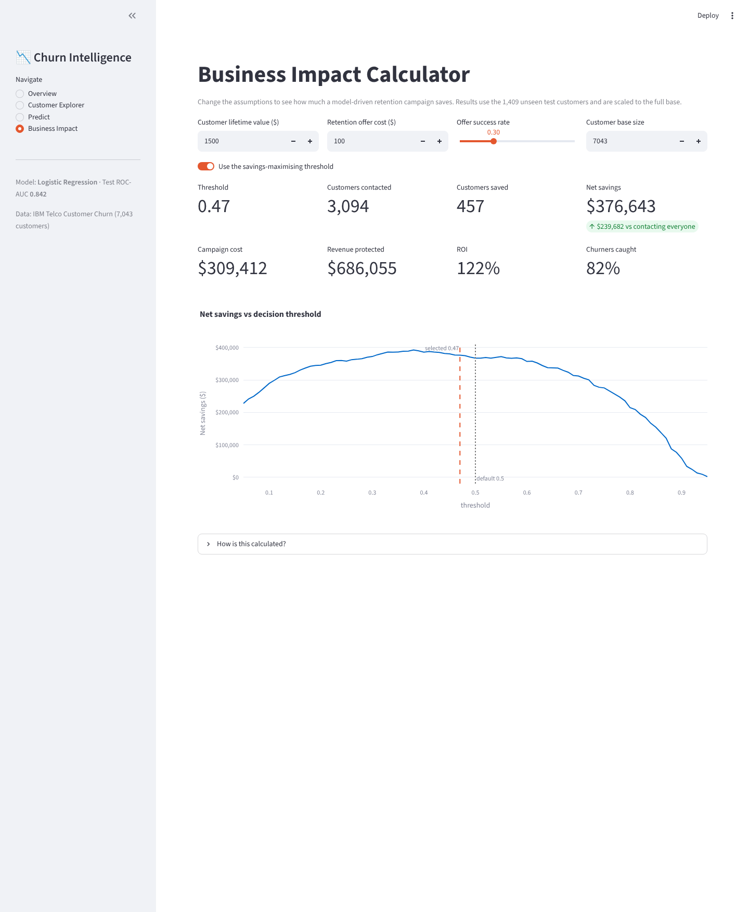
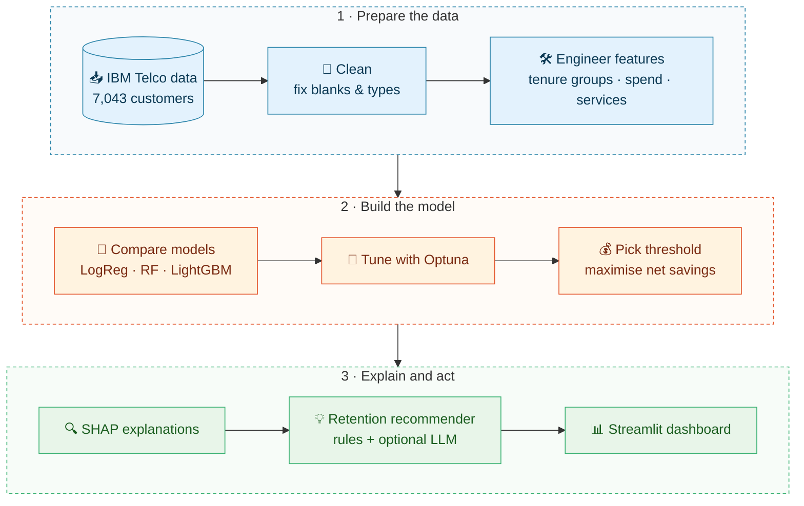
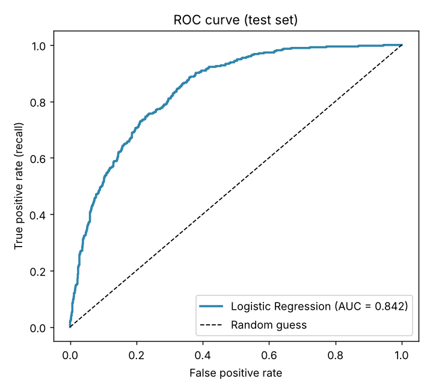
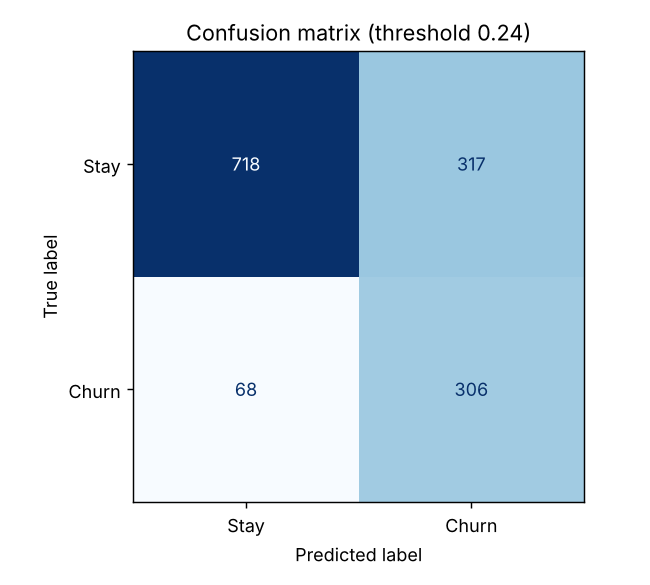
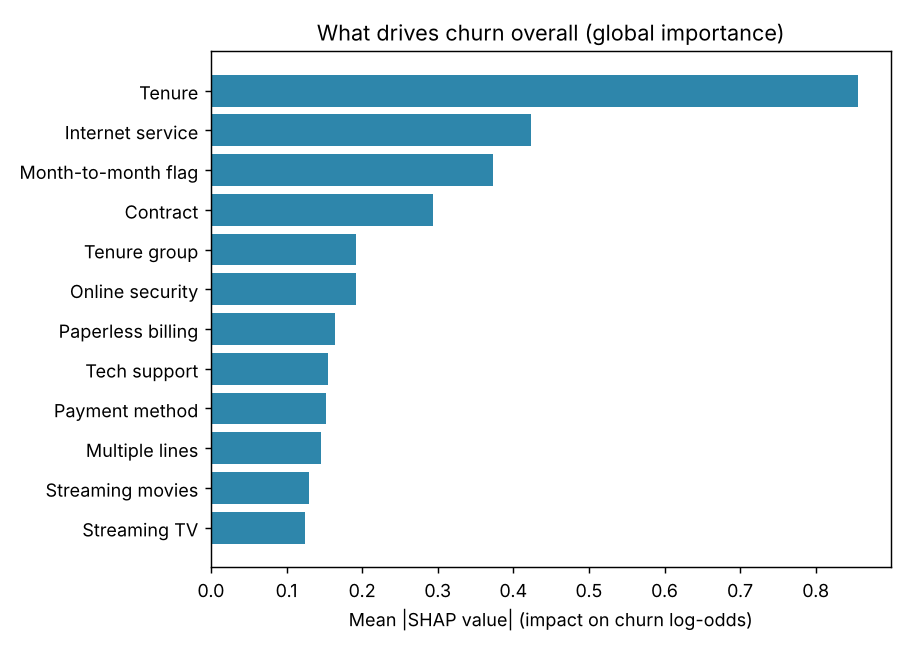
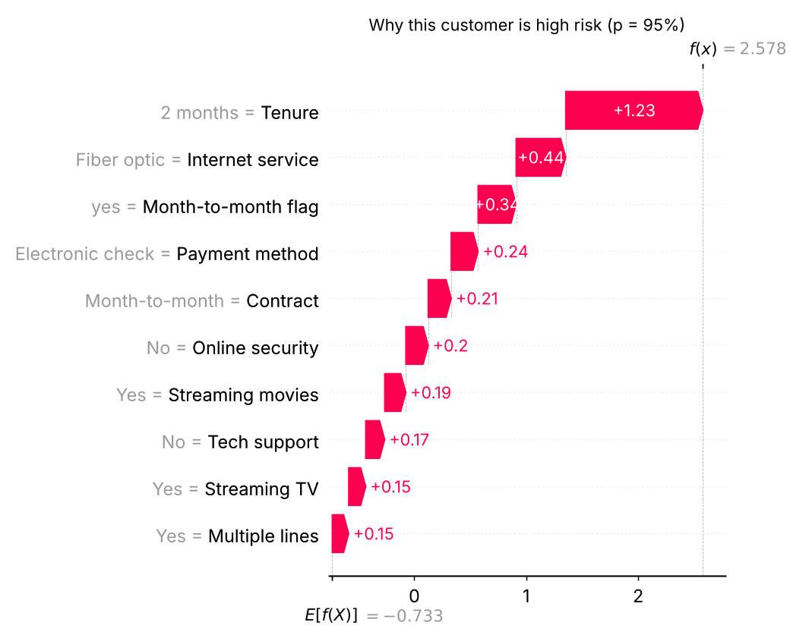
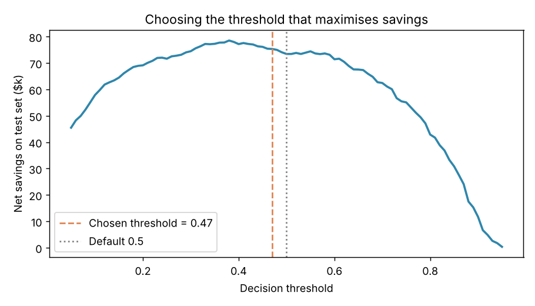

# 📉 Customer Churn Prediction with an Explainable AI Dashboard

**Predict which customers will leave, explain *why* in plain English, and turn it into a retention plan worth ~$377k per campaign.**


> 🔗 **Live demo:** `https://<your-app-name>.streamlit.app` *(add after deploying, see [Deployment](#-deploy-for-free-on-streamlit-community-cloud))*



---

## 💼 Business Problem

A subscription telecom company is losing **26.5% of its customers**, and with them **$139k of monthly recurring revenue (31%)**. Management asked three questions:

1. **Who** is likely to leave next?
2. **Why** are they leaving?
3. **What** should we do about it, and is it worth the money?

This project answers all three with a machine-learning model, customer-level explanations, an automated retention recommendation for every customer, and a calculator that turns predictions into dollars.

## 📊 Key Results

All numbers are measured on **1,409 customers the model never saw during training**.

| Metric | Result |
|---|---|
| ROC-AUC (test) | **0.842** (5-fold CV: 0.846) |
| Churners caught (recall) | **82%** (305 of 374) |
| Precision | 49%: about 1 in 2 contacted customers was a real churner |
| Decision threshold | **0.47**, chosen by a cost model instead of the default 0.5 |
| Net savings on the test group | **$75,350** per campaign, **122% ROI** |
| Projected for the full 7,043-customer base | **≈ $377,000 per campaign** |
| vs. "send everyone an offer" | **2.7× more savings** ($75.4k vs $27.4k) at 44% of the contacts |

*Assumptions (editable live in the dashboard): customer lifetime value $1,500, retention offer $100, 30% of contacted churners are saved.*

**What drives churn** (SHAP global importance): short tenure, fiber-optic service, month-to-month contracts, electronic-check payments, and no online security or tech support.

| Risk factor | Churn rate | Recommended action |
|---|---|---|
| Month-to-month contract | 43% (vs 3% on 2-year) | Annual-contract discount |
| First 12 months | 47% | Onboarding programme |
| Electronic check | 45% (vs ~16% auto-pay) | Auto-pay incentive |
| No tech support | 42% (vs 15% with) | Free support trial |

## 🖥️ Dashboard

| Overview | Customer Explorer |
|---|---|
|  |  |
| **Predict** | **Business Impact** |
|  |  |

- **Overview**: KPIs, churn by contract and tenure, top churn drivers, and the customer base split by risk level.
- **Customer Explorer**: filter current customers by contract, service, payment method, risk and tenure. Download a prioritised **call list** as CSV and click any customer to see why they are at risk.
- **Predict**: enter a new customer's details and get a churn probability, a SHAP explanation and a plain-English **retention recommendation**.
- **Business Impact**: change CLV, offer cost, success rate and base size to see campaign cost, revenue protected, ROI and the savings-vs-threshold curve update live.

<!-- Optional: record a 20-second GIF of the dashboard and add it here -->
<!--  -->

## ⚙️ How It Works



1. **Data** (`data/get_data.py`, `src/data_prep.py`): downloads the public dataset, or generates a synthetic copy if offline. Blank `TotalCharges` belong to brand-new customers (tenure 0), so they are set to 0 instead of being dropped or mean-imputed. Duplicates are removed and data types fixed.
2. **EDA** (`notebooks/01_eda.ipynb`): churn by contract, tenure, charges and payment method, each with a one-sentence business insight.
3. **Features** (`src/features.py`): tenure groups, average monthly spend, number of services, month-to-month and auto-pay flags, recent price change.
4. **Modelling** (`src/train.py`): Logistic Regression vs Random Forest vs LightGBM with stratified 5-fold CV. **Class imbalance is handled with class weights rather than SMOTE**: no synthetic rows, no risk of leaking oversampled points across folds, and all three models support it natively. The winner is tuned with **Optuna**. Logistic Regression won narrowly, which is good news for the business: it is the fastest and most transparent model.
5. **Threshold and evaluation** (`src/evaluate.py`): a missed churner costs about $450 (30% × $1,500 of savable value) and a wasted offer costs $100, so the threshold is chosen to **maximise net savings** on out-of-fold training predictions. The test set is never used for tuning.
6. **Explainability** (`src/explain.py`): SHAP values are aggregated back to business features ("Contract = Month-to-month", not "Contract_0"), turned into a plain-English explanation, and mapped to retention actions by a rule engine. An **optional LLM hook** rewrites the text when `ANTHROPIC_API_KEY` or `OPENAI_API_KEY` is set.
7. **Business impact** (`src/business.py`): campaign cost, revenue protected, net savings and ROI for any assumptions.

<details>
<summary>📈 Model reports (ROC, confusion matrix, SHAP)</summary>

| ROC curve | Confusion matrix |
|---|---|
|  |  |
| **SHAP global importance** | **Why one customer is high risk** |
|  |  |


</details>

## 🧰 Tech Stack

**Python 3.13** · pandas · NumPy · scikit-learn · LightGBM · Optuna · SHAP · Streamlit · Plotly · Matplotlib / Seaborn · Jupyter · pytest

## 🚀 How to Run

```bash
# 1. Clone and install
git clone https://github.com/jamal-uddin537/customer-churn-explainable-ai.git
cd customer-churn-explainable-ai
python -m venv .venv
source .venv/bin/activate        # Windows: .venv\Scripts\activate
pip install -r requirements.txt

# 2. Run the full pipeline: data -> clean -> train -> evaluate -> SHAP (~3-4 min)
python run_pipeline.py           # add --fast for a 1-minute run, --synthetic to work offline

# 3. Launch the dashboard
streamlit run app/streamlit_app.py

# 4. Run the tests
pytest -q
```

The trained model, processed data and reports are committed, so **step 3 works immediately** after installing.

**Optional, AI-written recommendations:** `pip install anthropic` (or `openai`), then `export ANTHROPIC_API_KEY=...` before launching the app. Without a key the app uses the built-in rule engine.

### Project structure

| | Path | What it does |
|:-:|---|---|
| 📊 | [`app/streamlit_app.py`](app/streamlit_app.py) | 4-page interactive dashboard |
| 📥 | [`data/get_data.py`](data/get_data.py) | Downloads the dataset, or generates a synthetic copy offline |
| 🗂️ | [`data/raw/`](data/raw) · [`data/processed/`](data/processed) | Raw CSV, cleaned data, test set, out-of-fold predictions |
| 📓 | [`notebooks/01_eda.ipynb`](notebooks/01_eda.ipynb) | Exploratory analysis with a business insight under every chart |
| ⚙️ | [`src/config.py`](src/config.py) | Paths, random seed and business assumptions |
| 🧹 | [`src/data_prep.py`](src/data_prep.py) | Data cleaning, with each decision documented |
| 🛠️ | [`src/features.py`](src/features.py) | Feature engineering and preprocessing pipeline |
| 🤖 | [`src/train.py`](src/train.py) | Cross-validated model comparison and Optuna tuning |
| 🎯 | [`src/evaluate.py`](src/evaluate.py) | Metrics, cost-based threshold and evaluation charts |
| 🔍 | [`src/explain.py`](src/explain.py) | SHAP, plain-English explanations, recommender, LLM hook |
| 💰 | [`src/business.py`](src/business.py) | Savings and ROI calculator |
| 🧠 | [`models/`](models) | Saved model pipeline and model info |
| 📈 | [`reports/`](reports) | Metrics, model comparison and figures |
| ✅ | [`tests/`](tests) | pytest unit tests |
| ▶️ | [`run_pipeline.py`](run_pipeline.py) | One command to rebuild everything |

## ☁️ Deploy for free on Streamlit Community Cloud

1. Push this repo to GitHub (public).
2. Go to **[share.streamlit.io](https://share.streamlit.io)** and sign in with GitHub.
3. Click **Create app → Deploy a public app from GitHub**.
4. Repository: `jamal-uddin537/customer-churn-explainable-ai`, Branch: `main`, Main file path: `app/streamlit_app.py`.
5. Open **Advanced settings** and choose **Python 3.13**, so the saved model loads with the same library versions. Optionally add `ANTHROPIC_API_KEY = "..."` under *Secrets*.
6. Choose a custom URL (e.g. `churn-xai-jamal`) and click **Deploy**. The first build takes 3–5 minutes.
7. Paste the live URL into the "Live demo" line at the top of this README.

## 🤝 What I Can Build for You

I'm a data scientist (Master's student in China) who builds **machine-learning solutions that answer business questions**, not just notebooks.

- **Churn prediction and retention analytics**: who will leave, why, and which offer to send.
- **Sales and demand forecasting**: time-series models (Prophet, LightGBM, ARIMA) with confidence ranges.
- **Customer segmentation**: RFM and clustering to find your most valuable groups.
- **Interactive dashboards**: Streamlit, Plotly Dash or Power BI that non-technical teams actually use.
- **Explainable AI**: SHAP and feature-importance reports that make models trustworthy for managers and regulators.
- **Data cleaning and EDA**: turning messy spreadsheets and databases into clear insights.
- **LLM-powered analytics**: automated reports and recommendations with OpenAI or Anthropic models.

📬 **Need something similar?** Contact me on **[Upwork](https://www.upwork.com/)** *(replace with your profile link)* or open an issue on this repo.

## 📄 Data and License

Data: [IBM Telco Customer Churn](https://github.com/IBM/telco-customer-churn-on-icp4d), a public sample dataset of 7,043 customers. If the download fails, `data/get_data.py` generates a **synthetic** dataset with the same columns and realistic churn patterns, and records the source in `data/raw/SOURCE.txt`. The committed results use the **real IBM data**.

Code released under the [MIT License](LICENSE).
